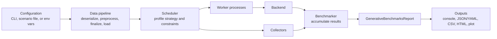

# Architecture

GuideLLM evaluates and optimizes large language model (LLM) deployments by simulating real-world inference workloads. Its components are decoupled so that data sources, backends, scheduling strategies, and reporting can be changed independently.

## Component Flow

## Core Components

### 1. **Configuration**

Benchmarks are configured through the CLI (`guidellm run`), one or more scenario files (`--config`), or `GUIDELLM__SPEC__...` environment variables. All three forms populate the same `BenchmarkScenario` schema, whose `spec` field is a `BenchmarkArgs` object containing the backend, profile, constraints, data pipeline, tokenizer, metrics, collectors, and outputs.

- **Responsibilities:**
  - Select registered implementations with the `kind=` prefix (for example, `--profile kind=sweep`)
  - Merge scenario files and command-line overrides in order
  - Validate the complete configuration before any requests are sent

### 2. **Data Pipeline**

The data pipeline lives in `guidellm/data` and converts a dataset definition into a stream of `GenerationRequest` objects.

- **Deserializers** turn a source into a Hugging Face dataset. Supported kinds include `synthetic_text`, `synthetic_image`, `synthetic_video`, `huggingface`/`hf`, file kinds such as `json_file` and `parquet_file`, in-memory kinds, and trace formats such as `trace_synthetic` and `otel`.
- **Preprocessors** map dataset columns (`generative_column_mapper`, `pooling_column_mapper`), encode media (`encode_media`), transpose turn columns (`turn_pivot`), and prepare tool-call turns (`tool_calling`).
- **Finalizers** (`generative`, `conversation_graph`) build requests and, for multiturn data, the conversation graph.
- **Data loaders** (`pytorch`) stream rows and apply `samples` limits.
- **Tokenizers** (`huggingface_auto`) compute token counts, defaulting to the model reported by the backend.

### 3. **Scheduler**

The `Scheduler` in `guidellm/scheduler` turns a profile into one or more scheduling strategies and enforces constraints while requests run.

- **Responsibilities:**
  - Run the strategies generated by the configured profile (`synchronous`, `throughput`, `concurrent`, `constant`/`poisson`, `sweep`, `knee`, `goodput`, or `replay`)
  - Apply constraints such as `max_duration`, `max_requests`, `min_requests`, `max_errors`, `max_error_rate`, `max_global_error_rate`, and `over_saturation`
  - Track warmup and cooldown windows that are excluded from the measured results
  - Dispatch requests to worker processes and enforce turn dependencies for multiturn conversations

### 4. **Worker Processes**

Worker processes send requests concurrently and return responses plus timing information to the scheduler. They are started with `spawn` or `forkserver` multiprocessing; `fork` is not supported. Worker pool size and messaging behavior are controlled by `GUIDELLM__...` settings such as `GUIDELLM__MAX_WORKER_PROCESSES`.

### 5. **Backend**

The `Backend` is an abstract interface for interacting with inference servers. GuideLLM ships with OpenAI-compatible HTTP and WebSocket backends, an in-process vLLM Python backend (`vllm_python_async`, also accepted as `vllm_python`), a vLLM Python batch backend (`vllm_python_batch`), and a vLLM gRPC backend (`vllm_grpc`).

- **Responsibilities:**
  - Validate backend readiness and resolve the model when it is not configured explicitly
  - Format and send requests
  - Parse streaming and non-streaming responses, including token usage and tool calls

### 6. **Collectors**

Collectors in `guidellm/collectors` gather data from outside GuideLLM while benchmarks run. The built-in `prometheus` collector scrapes a metrics endpoint in a separate process and attaches its summary to each benchmark result.

### 7. **Benchmarker and Results**

The `Benchmarker` in `guidellm/benchmark` runs a profile's strategies and aggregates each one with `GenerativeBenchmarkAccumulator` into a `GenerativeBenchmark`. Each benchmark contains `SchedulerMetrics` and `GenerativeMetrics`, including status breakdowns, percentile distributions, confidence intervals, SLO attainment, warnings, and collector results.

`GenerativeBenchmarksReport` collects the benchmarks, the merged configuration, and any profile conclusions (for example, knee or goodput analysis), and writes the requested outputs from `guidellm/benchmark/outputs`: console, CSV, HTML, plot, and JSON/YAML.

### 8. **Progress and Warnings**

`guidellm/benchmark/progress.py` reports setup and benchmark progress to the console and logs. After each benchmark, warning rules from `guidellm/schemas/benchmark/warnings.py` are evaluated against the compiled metrics and recorded in the report; warnings never stop the run.

## Package Layout

| Package               | Responsibility                                                    |
| --------------------- | ----------------------------------------------------------------- |
| `guidellm.cli`        | Click-based commands for `run`, `preprocess`, `export`, and more  |
| `guidellm.schemas`    | Pydantic argument, request, response, metric, and report schemas  |
| `guidellm.data`       | Deserializers, preprocessors, finalizers, loaders, and tokenizers |
| `guidellm.backends`   | Backend implementations and request handlers                      |
| `guidellm.scheduler`  | Strategies, constraints, worker processes, and DAG execution      |
| `guidellm.collectors` | Collectors that gather external data during a benchmark           |
| `guidellm.benchmark`  | Benchmark orchestration, metrics, progress, warnings, and outputs |
