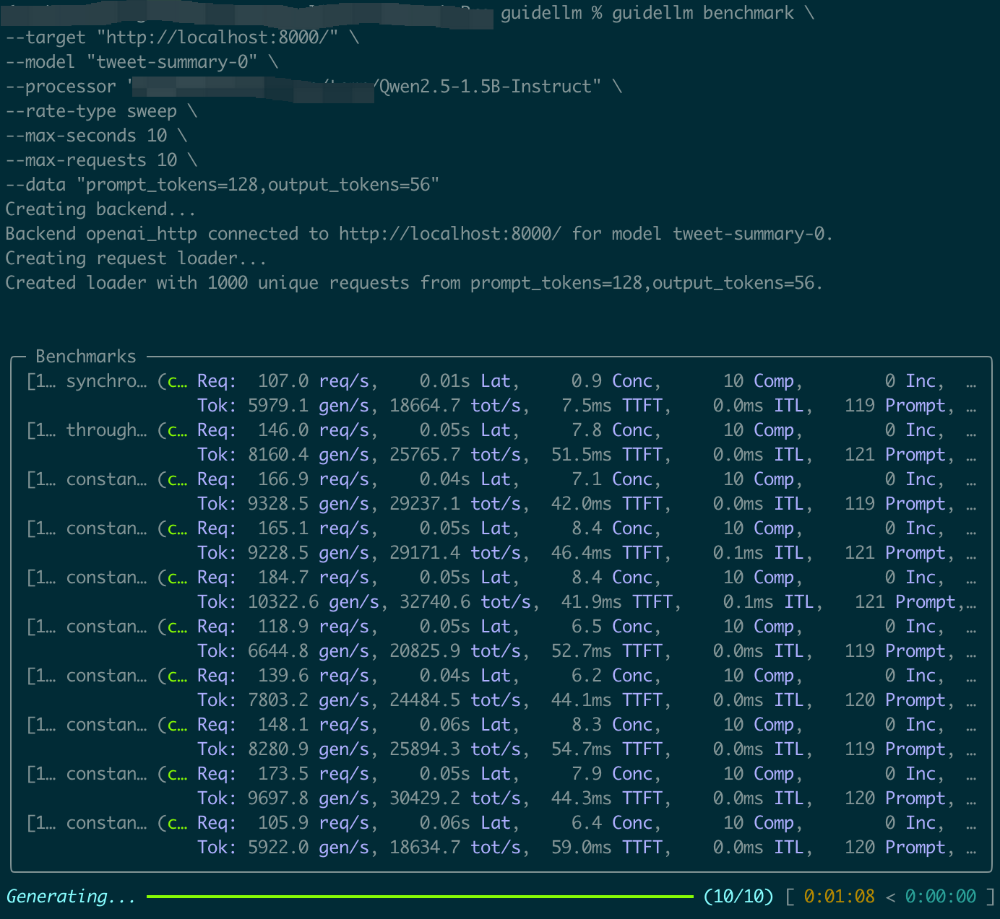
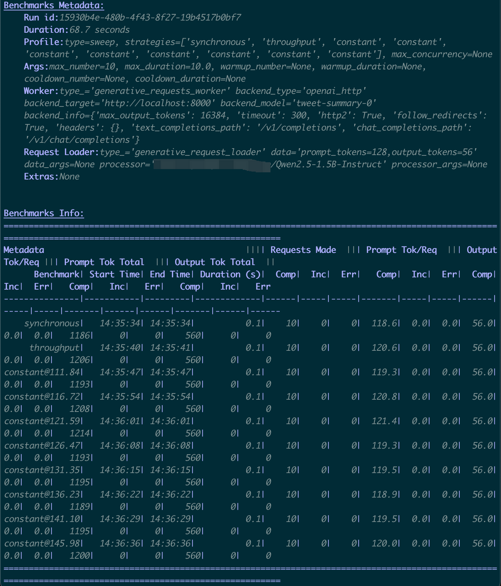
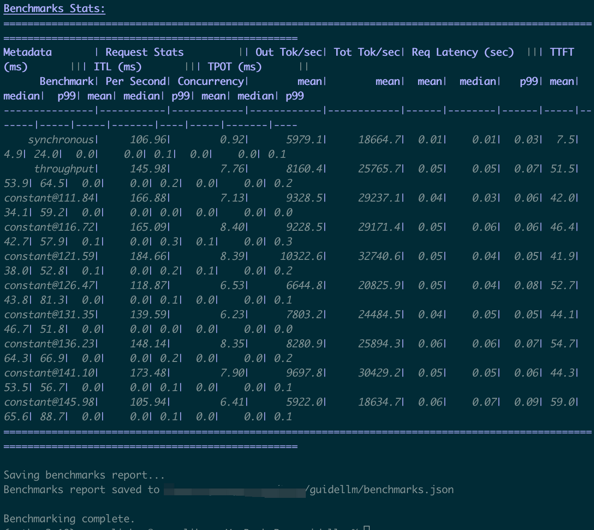

# GuideLLM 基准测试最佳实践 {#guidellm-benchmark-testing-best-practice}

从零开始，使用 vLLM Simulator 轻松完成首次 GuideLLM 基准测试。

## 开始使用

### 📦 1. 设置基准测试环境

#### 1.1 创建 Conda 环境（推荐）

```bash
conda create -n guidellm-bench python=3.11 -y
conda activate guidellm-bench
```

#### 1.2 安装依赖

```bash
git clone https://github.com/vllm-project/guidellm.git
cd guidellm
pip install guidellm
```

如需了解详细说明，请参阅 [GuideLLM README](https://github.com/vllm-project/guidellm/blob/main/README.md)。

#### 1.3 验证安装

```bash
guidellm --help
```

#### 1.4 在 vLLM Simulator Docker 容器中启动兼容 OpenAI 的 API

```bash
docker pull ghcr.io/llm-d/llm-d-inference-sim:v0.4.0

docker run --rm --publish 8000:8000 \
ghcr.io/llm-d/llm-d-inference-sim:v0.4.0  \
--port 8000 \
--model "Qwen/Qwen2.5-1.5B-Instruct"  \
--lora-modules '{"name":"tweet-summary-0"}' '{"name":"tweet-summary-1"}'
```

如需了解详细说明，请参阅：[vLLM Simulator](https://llm-d.ai/docs/architecture/Components/inference-sim)

Docker 镜像版本：[Docker Images](https://github.com/llm-d/llm-d-inference-sim/pkgs/container/llm-d-inference-sim)

通过 curl 检查 OpenAI API 是否正常工作：

- 检查 `/v1/models`

```bash
curl --request GET 'http://localhost:8000/v1/models'
```

- 检查 `/v1/chat/completions`

```bash
curl --request POST 'http://localhost:8000/v1/chat/completions' \
--header 'Content-Type: application/json' \
--data-raw '{
    "model": "tweet-summary-0",
    "stream": false,
    "messages": [{"role": "user", "content": "Say this is a test!"}]
}'
```

- 检查 `/v1/completions`

```bash
curl --request POST 'http://localhost:8000/v1/completions' \
--header 'Content-Type: application/json' \
--data-raw '{
    "model": "tweet-summary-0",
    "stream": false,
    "prompt": "Say this is a test!",
    "max_tokens": 128
}'
```

#### 1.5 下载分词器

从 [Qwen/Qwen2.5-1.5B-Instruct](https://modelscope.cn/models/Qwen/Qwen2.5-1.5B-Instruct/files) 下载 Qwen/Qwen2.5-1.5B-Instruct 分词器文件，并保存到本地路径，例如 `${local_path}/Qwen2.5-1.5B-Instruct`。

```bash
ls ./Qwen2.5-1.5B-Instruct
merges.txt              tokenizer.json          tokenizer_config.json   vocab.json
```

______________________________________________________________________

## 🚀 2. 运行基准测试

```bash
guidellm run \
  --backend kind=openai_http,target=http://localhost:8000/,model=tweet-summary-0 \
  --tokenizer kind=huggingface_auto,model=${local_path}/Qwen2.5-1.5B-Instruct \
  --profile kind=sweep \
  --constraint kind=max_duration,seconds=10 \
  --constraint kind=max_requests,count=10 \
  --data kind=synthetic_text,prompt_tokens=128,output_tokens=56
```

______________________________________________________________________

## 📊 3. 结果解读

  

基准测试完成后，可以清楚地看到以下关键结果：

- **`TTFT`**：首 Token 时间（Time to First Token）
- **`TPOT`**：每个输出 Token 的耗时（Time Per Output Token）
- **`ITL`**：Token 间延迟（Inter-Token Latency）

首次基准测试已完成。
